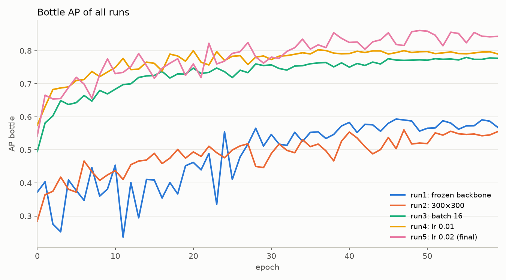
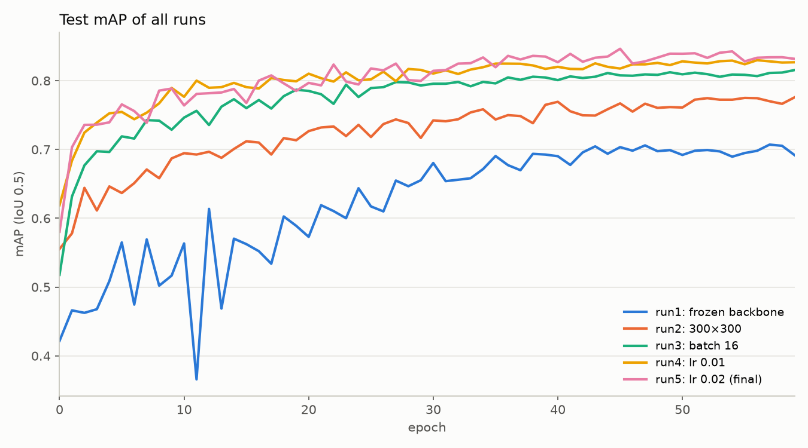
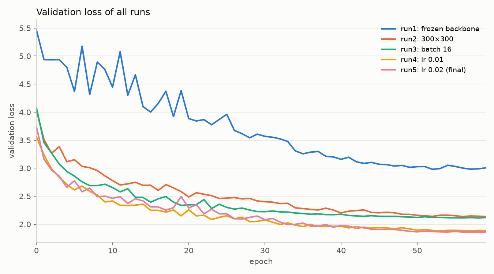
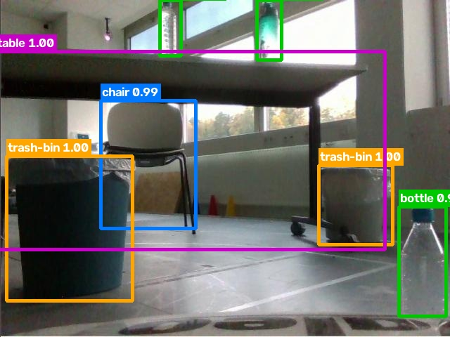
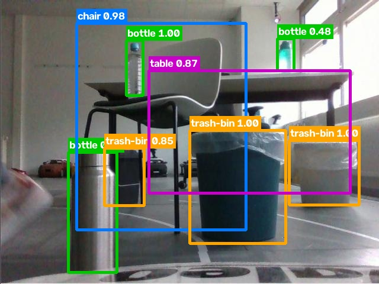
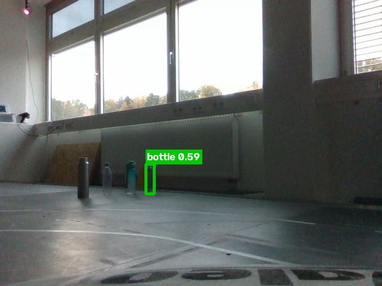
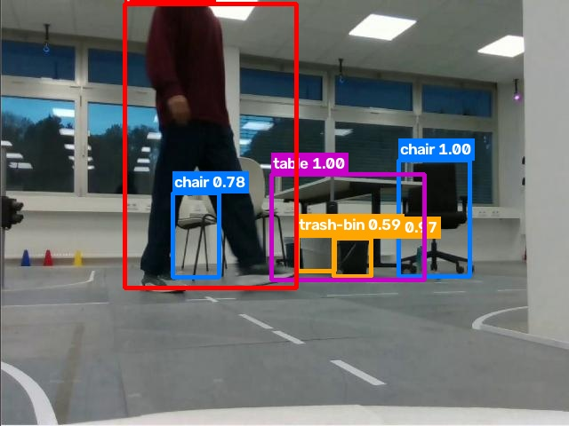
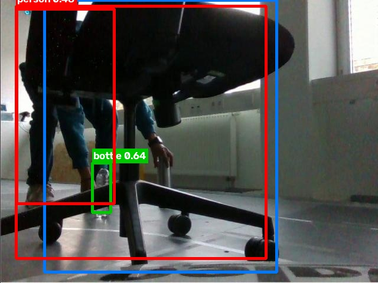
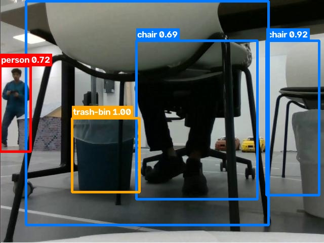
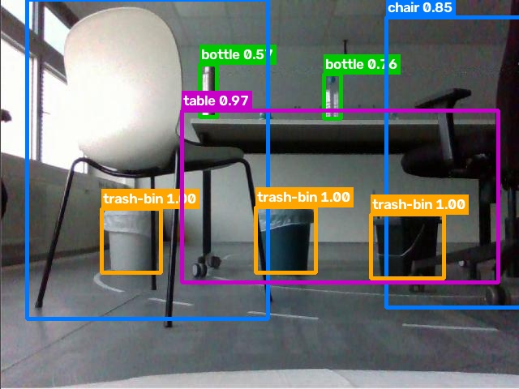

# Plan: Object Detection using Transfer Learning

Goal: Make a small object detector for our robot. The detector runs on the
**NVIDIA Jetson Orin** of the model car. It finds **5 classes** in the lab:

`trash-bin` · `bottle` · `table` · `chair` · `person`

## Acceptance criteria

**User story:** As a developer I want the robot to recognize people, chairs,
tables, bottles and trash bins around it, so that it can find its way
around them while cleaning.

This table shows where this plan satisfies each acceptance criterion.

| Criterion and Requirement | What we did | Sections | info | Status |
|---------------------------|-------------|----------|------|--------|
| [US-1: Dataset Recording and Annotation](https://gitlab.hs-coburg.de/aegis-robot/objectlocalization/-/work_items/6): dataset from the robot camera, 2D boxes, training / evaluation / test split | 244 photos + 12 videos → 1,274 verified images (640×480, 8,592 boxes, checked by hand on Roboflow) → 86 near-copies removed → dataset of 1,188 images, split 950 / 119 / 119 (80 / 10 / 10 %) | [1](#1-capturing-the-data), [2](#2-data-preparation), [3](#3-automatic-annotation), [4](#4-review-and-correction), [5](#5-training--evaluation--test-split) | [verified dataset (Roboflow)](https://app.roboflow.com/archives-workspace/aegis_dataset_clean/2) | Done |
| [US-2: Pretrained Detection Model Baseline](https://gitlab.hs-coburg.de/aegis-robot/objectlocalization/-/work_items/7): a pretrained detection model runs | Default (pretrained) model tested in the lab: 60 trials, distance × angle × light. Good for person and chair, weak for table, bottle and trash bin | [4](#pretrained-model-test-us-2) | [Performance Evaluation Report](https://gitlab.hs-coburg.de/aegis-robot/aegis/-/blob/main/docs/Object_Detection.pdf) | Done |
| [US-3: Transfer Learning Training](https://gitlab.hs-coburg.de/aegis-robot/objectlocalization/-/work_items/8): transfer learning on our dataset, loss curves documented | SSD-MobileNet-v1, start from pretrained VOC weights, 5 new classes, 5 training runs of 60 epochs on 1,069 images; final model 512×512 | [6](#6-training-transfer-learning), [7.2](#72-run1-baseline), [7.6](#76-all-runs-and-final-model) | Loss values of all runs; comparison charts of mAP and loss | Done |
| [US-4: Evaluation on Test Dataset](https://gitlab.hs-coburg.de/aegis-robot/objectlocalization/-/work_items/9): evaluation on the test set with mAP, documented | mAP (VOC, IoU 0.5) and AP for each class of the PyTorch model on the 119 test images; final model run5: mAP 0.832; visual evaluation of failure cases | [7.1](#71-metric-and-method), [7.6](#76-all-runs-and-final-model), [7.8](#78-visual-evaluation-of-failure-cases) | mAP tables, failure images | Done |
| [US-5: Hyperparameter Tuning](https://gitlab.hs-coburg.de/aegis-robot/objectlocalization/-/work_items/10): metrics improved by more training runs with hyperparameter tuning, documented | Baseline run1 (frozen backbone, mAP 0.692) → runs that test backbone, input size, batch size and learning rate → final model run5 (mAP 0.832, bottle AP 0.569 → 0.843) | [6.2](#62-baseline-runs-and-final-model), [7.2](#72-run1-baseline), [7.3](#73-input-size-run2), [7.4](#74-batch-size-run3), [7.5](#75-learning-rate-run4-and-run5), [7.6](#76-all-runs-and-final-model), [7.7](#77-limits) | Run comparison tables | Done |
| [US-6: Live Detection on Jetson](https://gitlab.hs-coburg.de/aegis-robot/objectlocalization/-/work_items/11): the fine-tuned model runs on the Jetson with live camera data, output visible | ONNX export of the final model run5, TensorRT on the Jetson Orin with the robot camera, boxes shown on the screen | [8](#8-export-to-onnx), [9](#9-run-the-model-on-the-jetson-orin) | Video of the live output, FPS | To do |

## Contents

1. [Capturing the data](#1-capturing-the-data)
2. [Data preparation](#2-data-preparation)
3. [Automatic annotation](#3-automatic-annotation)
4. [Review and correction](#4-review-and-correction)
5. [Training / evaluation / test split](#5-training--evaluation--test-split)
6. [Training (transfer learning)](#6-training-transfer-learning)
7. [Evaluation and hyperparameter tuning](#7-evaluation-and-hyperparameter-tuning)
8. [Export to ONNX](#8-export-to-onnx)
9. [Run the model on the Jetson Orin](#9-run-the-model-on-the-jetson-orin)

---

## 1. Capturing the data

> **Criterion:** [US-1: Dataset Recording and Annotation](https://gitlab.hs-coburg.de/aegis-robot/objectlocalization/-/work_items/6)

All images come from the camera of the robot. Thus, the training images
look the same as the images that the detector gets on the Jetson.

### 1.1 Sources and image numbers

All images are named with a number:

| Source | Recorded | Size recorded | Size in the dataset | Image numbers | Images in the dataset |
|--------|----------|---------------|---------------------|---------------|----------------------:|
| Photos | 244 photos | 640×480 PNG | 640×480 | 1-244 | 222 |
| Videos | 12 videos (27.1 min) | `.webm`, 1645×1232 | 640×480 | 245-1274 | 966 |
| **Total** | | | | **1-1274** | **1,188** |

- **Photos:** saved directly from the camera stream, at the camera
  resolution of 640×480.
- **Videos:** screen recordings of the camera stream in rqt. Thus, they
  have the size of the screen recording (1645×1232), not the camera
  resolution. 1645×1232 has the same 4:3 shape as 640×480 (1645 / 1232 =
  1.335, 640 / 480 = 1.333). We resized all video frames to 640×480.
- We converted the videos to images and removed exact copies
  ([section 2](#2-data-preparation)).

Some numbers are not used, because we removed images that are too similar
to a test image ([section 5](#5-training--evaluation--test-split)).

**Where the data is:** The images are not in this
git repository because of their size. On Roboflow, there are two projects:

- [Aegis Object Detection](https://app.roboflow.com/archives-workspace/aegis-object-detection-iskto/browse?queryText=&pageSize=100&startingIndex=0&browseQuery=true): the images with the boxes checked by hand
  ([section 4](#4-review-and-correction)), before the near-copies were
  removed.
- [Aegis Dataset Clean](https://app.roboflow.com/archives-workspace/aegis-dataset-clean/browse?queryText=&pageSize=100&startingIndex=0&browseQuery=true):
  the dataset after the near-copies were removed
  ([section 5](#5-training--evaluation--test-split)). All training runs
  use this dataset.

### 1.2 Object size (near / far)

We did not measure the distance from the
camera to each object. Thus, we use the height of the box in the image:

| Term in this plan | Box height in the image            | At 640×480      |
|-------------------|------------------------------------|-----------------|
| small (far)       | less than 10 % of the image height | < 48 px         |
| medium            | 10 % to 40 %                       | 48 px to 192 px |
| large (near)      | 40 % or more                       | ≥ 192 px        |

[Section 7.3](#73-input-size-run2) shows how many boxes of each class are
small, medium and large.

### 1.3 How we planned the recordings

**Why we recorded this way.** The pretrained model was weak for trash
bin, table and bottle, and bottle was weak in bright light
([section 4](#pretrained-model-test-us-2)). Thus, we put many bottles and
bins in each scene and recorded against the bright windows on purpose
(list below).

We recorded all images on 20.10.2026. In the list below, the numbers after
*Images:* show which images have this
([section 1.1](#11-sources-and-image-numbers) explains the image numbers).

- **Camera close to the floor.** The camera is a few centimetres above the
  floor. It sees most tables from below and often only the legs of people.
  The front of the robot is at the bottom of each image.
  *Images:* 109-129, 161-180, 303-371, 552-660 (tables from below);
  245-300 (only the legs of people); 948-960, 1115-1127, 1147-1153 (chairs
  from below).
- **Backlight on purpose.** We put the objects between the camera and the
  large windows. The sun is behind the objects: they look dark, and the
  background is overexposed. Clear plastic bottles are almost invisible in
  front of the bright window. The detector must also work in this light on
  the robot.
  *Images:* 1-65, 245-370, 392-551, 661-797; strongest sunlight (some
  areas fully white): 141-170.
- **Different light.** We recorded from the late afternoon to the evening.
  *Images:* 245-797 (afternoon sun); 798-922 (late afternoon, ceiling
  lights on); 923-1274 (evening: after sunset, blinds closed, ceiling
  lights on); 74-108 (normal light: the camera points away from the
  windows); 222-244 (dark: the camera adjusts to the bright windows, so the
  image is too dark).
- **Many types of each class:**
  - bottles: clear plastic, silver metal and coloured sports bottles;
    standing (85-103), lying and rolling on the floor (408-431, 1218-1250);
  - trash-bins: blue, white, grey and black, with and without plastic bags;
    bins of different colours next to each other (130-137), so the detector
    learns the shape, not one colour;
  - chairs: black office chairs and white plastic chairs (1-72);
  - tables: white desks, seen from below (109-129), from the side (809) and
    from far away (848-858);
  - people: walking (245-275), bending down (401-436), sitting (29-32,
    757-787), only partly in the image (245-300), moving bottles (392-476),
    bins (486-511) and chairs (512-540).
- **Near and far, floor and table** (near / far: [section 1.2](#12-object-size-near--far)).
  *Images:* 74-108 (objects on the table); 222-238 (bins near the camera);
  242-244 (bottles far away); 848-858, 1015-1021, 1187-1194 (small objects
  far away); 833-841 (a person far away at the window).
- **Objects hide each other**, for example a bin behind a bottle, a chair
  behind the legs of a person, a person on a chair.
  *Images:* 27-32, 308-333, 776-793 (all 5 classes in one image); 754-797
  (a person stands at the table, sits down and walks past).
- **Objects that are not our classes:** traffic cones, toy cars, model
  traffic lights, a model house, plants and wooden boards. The detector
  must **not** find them.
  *Images:* 1-40, 141-160 (cones); 86-108 (toy cars, model house);
  1155-1274 (model road with traffic lights, the real task of the robot).
- **Movement.** The robot drives around and between the objects. Thus, the
  camera sees each scene from many angles and distances.
  *Images:* 245-1274; 798-832 and 1180-1185 show the inner
  part of the room, not only the corner with the windows.

---

## 2. Data preparation

> **Criterion:** [US-1: Dataset Recording and Annotation](https://gitlab.hs-coburg.de/aegis-robot/objectlocalization/-/work_items/6)

**Why videos?** The robot moves. A video records each scene from many
positions, angles and distances, and in changing light, with little work.
244 photos alone are too few for training.

The 12 videos have 47,000 frames. Most of them are almost the same, or
blurred by the movement. We kept only the useful frames:

1. **One frame each second:** the sharpest frame of each second (1,631
   frames).
2. **Bad frames removed:** frames that are blurred (less than 60 % of the
   median sharpness of the video) or too dark (mean brightness below 35 of
   255).
3. **Exact copies removed:** frames that are almost exactly the same as a
   frame we already kept, for example when the robot stands still or comes back to
   the same place.
4. **Resized** to 640×480 PNG, the same format as the photos.

Result: 1,083 video frames and 244 photos (1,327 images).
[Section 5](#5-training--evaluation--test-split) explains why the split is
not random.

---

## 3. Automatic annotation

> **Criterion:** [US-1: Dataset Recording and Annotation](https://gitlab.hs-coburg.de/aegis-robot/objectlocalization/-/work_items/6)

We made the first annotations automatically with three pretrained models.
All models run on the GPU of our computer (RTX 5070 Ti, 12 GB).

| Step   | Model | Task |
|--------|-------|------|
| Detect | [Grounding DINO (base)](https://huggingface.co/IDEA-Research/grounding-dino-base) | finds objects from text, for example "garbage bin" |
| Detect | [OWLv2 (large)](https://huggingface.co/google/owlv2-large-patch14-ensemble) | second detector, finds what Grounding DINO misses |
| Verify | [SigLIP2 (so400m)](https://huggingface.co/google/siglip2-so400m-patch14-384) | checks each box: one of our 5 classes or a different object |

Then, rules remove double boxes, boxes around groups or parts of objects,
and the front of the robot at the bottom of the image.

We also tried a third detector,
[MM-Grounding-DINO (large)](https://huggingface.co/openmmlab-community/mm_grounding_dino_large_all). On our images, it put the
boxes in the wrong positions. Thus, we did not use it.

**Images:** 49 images have none of the 5 classes. We removed them.
**Result:** 1,278 images with 7,120 boxes in Pascal VOC format. [Section 4](#4-review-and-correction) shows the boxes after the
check by hand.

| Class     | Boxes (automatic) |
|-----------|------------------:|
| bottle    | 2,504 |
| trash-bin | 2,079 |
| chair     | 1,388 |
| table     |   680 |
| person    |   469 |

### Why the classes have different numbers of boxes

Bottle, trash-bin and chair have more boxes than table and person. This has
three causes:

1. **One image shows many bottles and bins, but few tables and people.**
   - Bottles and bins: we put many of them in each scene (different
     bottle types, bins in four colours, see [section 1](#1-capturing-the-data)).
   - Chairs: the lab has many chairs.
   - Tables: a table is large, so one image shows only one table or a part
     of it.
   - People: a person is only in the image when a team member walked into
     the scene.
2. **The classes that were weak in the pretrained model got more
   examples** ([section 4](#pretrained-model-test-us-2)).
3. **A large number of boxes is not the same as good results.** In the
   baseline run1 ([section 6](#6-training-transfer-learning)), bottle has the most boxes but the lowest
   AP (0.569), and person has few boxes but a higher AP (0.746). Thus,
   the different numbers of boxes do not explain the results. Object size
   is the main cause ([section 7.3](#73-input-size-run2)).

### Advantages

- **No manual work for 7,120 boxes.** The models make all annotations in
  about 80 minutes.
- **The same rules for all images.**
- **Two detectors and a check.** Together, they find more objects and make
  fewer incorrect boxes than one detector alone.

### Disadvantages

- **Some boxes are incorrect.** The models miss objects in very bright
  light, small objects and objects that are mostly hidden. They also put
  incorrect boxes on similar objects (example: the seat of a white chair,
  seen from below, got the label "table"). **A person must check the
  annotations** ([section 4](#4-review-and-correction)).
- **Large models.** About 8 GB of downloads, a strong GPU, and 3-4 seconds
  for each image.

---

## 4. Review and correction

> **Criterion:** [US-1: Dataset Recording and Annotation](https://gitlab.hs-coburg.de/aegis-robot/objectlocalization/-/work_items/6)

- **We verified all automatic annotations ([section 3](#3-automatic-annotation)) by hand on
  Roboflow.** We uploaded the images with their automatic boxes, checked
  each image, and corrected, deleted or added boxes.
- 3 images had no objects after the check, and 1 image had a wrong box.
  We removed these 4 images.

**Number of images in each step:**

| Step | Images | Section |
|------|-------:|---------|
| After the data preparation | 1,327 | [2](#2-data-preparation) |
| Images without any of the 5 classes removed (49) | 1,278 | [3](#3-automatic-annotation) |
| Images removed after the check by hand (4) → **verified images** | **1,274** | [4](#4-review-and-correction) |
| 86 images removed, because they look almost the same as a test image → **dataset** (training, evaluation and test) | **1,188** | [5](#5-training--evaluation--test-split) |

**Boxes after the check (1,274 verified images):**

| Class     | Automatic | After the check | Change |
|-----------|----------:|----------------:|-------:|
| bottle    |     2,504 |       **3,222** |   +718 |
| trash-bin |     2,079 |       **2,233** |   +154 |
| chair     |     1,388 |       **1,491** |   +103 |
| person    |       469 |         **906** |   +437 |
| table     |       680 |         **740** |    +60 |
| **Total** | **7,120** |       **8,592** | **+1,472** |

Most new boxes are bottles and persons. The automatic annotation missed
many small bottles, bottles in front of the windows, and people who are
only partly in the image.

### Pretrained model test (US-2)

> **Criterion:** [US-2: Pretrained Detection Model Baseline](https://gitlab.hs-coburg.de/aegis-robot/objectlocalization/-/work_items/7)

- In module 3, we ran the default (pretrained) detection model without
  our training, and tested it in the lab with 60 trials: 4 distances (100-400 cm) ×
  5 camera angles (-20° to +20°) × 3 light levels (bright, medium, dark).
  Report: *Object Detection Model — Performance Evaluation Report*
  (`Object_Detection.pdf`).

  | Class     | Detected | Detection rate | Avg. confidence |
  |-----------|---------:|---------------:|----------------:|
  | Person    |  60 / 60 |           100% |            74.0 |
  | Chair     |  57 / 60 |          95.0% |            75.7 |
  | Table     |  40 / 60 |          66.7% |            14.5 |
  | Bottle    |  45 / 60 |          75.0% |            21.3 |
  | Trash bin |  26 / 60 |          43.3% |            16.7 |

- **Result:** the pretrained model is good for person and chair, but weak
  for table, bottle and trash bin. Bottle drops to 40% in bright light.
  The report calls trash bin "the weakest class overall". Once, the model
  classified a trash bin as a suitcase, and once the ground as a table.
- **This is the reason for our own training (sections [6](#6-training-transfer-learning)-[7](#7-evaluation-and-hyperparameter-tuning)).** The default
  model was not trained for our lab, our camera view and our 5 classes.
- **This is also the reason why our dataset has many bottles and trash
  bins.** The report recommends more training examples, also in bright
  light. Thus, we recorded the weak classes more often
  ([section 1.3](#13-how-we-planned-the-recordings)): bottles are in 84 %
  and trash bins in 78 % of the 1,188 images. Tables are in 59 % of the
  images, more often than people (56 %), who were already detected
  reliably.
- This test uses detection rate in 60 trials, not mAP on our test images.
  Thus, its numbers cannot be compared directly with the mAP of our runs.

---

## 5. Training / evaluation / test split

> **Criterion:** [US-1: Dataset Recording and Annotation](https://gitlab.hs-coburg.de/aegis-robot/objectlocalization/-/work_items/6)

**Why the split is not random.** Images a few seconds apart show the same
scene from a slightly different position. With a random split, almost the
same image could be in the training part and in the test part, and the
test score would be too high.

**How we split:**

1. **Each recording on its own, in time order.** We split the images of
   each recording separately, in the order of the image numbers. The
   **last 10 %** of the images are test images, the 10 % before them are evaluation images,
   and the rest are training images. Thus, the test images are one block
   at the end of each recording, and every recording (all rooms, light
   conditions and classes) is in the test part.
2. **Near-copies removed.** [Section 2](#2-data-preparation) removed only
   exact copies. We also checked each training and evaluation image
   against the test images and removed the **86 images** that are almost
   the same as a test image (444 boxes). Thus, the model does not see a
   test image during training.
3. **Exact shares.** Most near-copies were training and evaluation images.
   Thus, we moved 9 test images to the evaluation part (only test images
   without a near-copy in the test part) and 3 evaluation images to the
   training part. The result is exactly 80 / 10 / 10 %.

| Part       | Images | Boxes | Share |
|------------|-------:|------:|------:|
| Training   |    950 | 6,637 |  80 % |
| Evaluation |    119 |   772 |  10 % |
| Test       |    119 |   739 |  10 % |
| **Total**  | **1,188** | **8,148** | 100 % |

Boxes of each class in the test part: bottle 246, trash-bin 205, chair
145, person 82, table 61.

---

## 6. Training (transfer learning)

> **Criterion:** [US-3: Transfer Learning Training](https://gitlab.hs-coburg.de/aegis-robot/objectlocalization/-/work_items/8)

Terms used in this plan:

- **Default model** ([section 4](#pretrained-model-test-us-2), US-2): the pretrained model of
  jetson-inference, without our training.
- **Run:** one complete training of 60 epochs with one group of settings.
  The results of a run are in `pytorch-ssd/models/runN/` (`train.log`,
  TensorBoard files, model files, result images of the test images).
- **Baseline (run1):** the simplest form of transfer learning. The
  pretrained backbone is **frozen**; only the extra SSD layers and the new
  detection heads learn. Baseline performance: **mAP 0.692** on the test
  images. All other runs are compared with it.
- **Final model (run5):** the run with the best settings (settings table in
  [section 6.1](#61-settings)).

### 6.1 Settings

Framework: the training code of jetson-inference (PyTorch,
`pytorch-ssd/train_ssd.py`). Thus, the trained model runs directly on the
Jetson.

Settings of the final model (run5):

| Setting             | Value                                                      |
|---------------------|------------------------------------------------------------|
| Model               | **SSD-MobileNet-v1**                                       |
| Start weights       | `mobilenet-v1-ssd-mp-0_675.pth`, pretrained on Pascal VOC (transfer learning) |
| Classes             | 5 classes + "background" (no object)                       |
| Input size          | **512×512** ([section 7.3](#73-input-size-run2))                                  |
| Backbone            | **not frozen**, learns 10× slower than the new layers      |
| Learning rate       | **0.02** (new layers), **0.002** (backbone), cosine decay (T = 60) |
| Batch size / epochs | **4** / 60                                                 |
| Optimizer           | SGD, momentum 0.9, weight decay 0.0005                     |
| Data                | 1,069 training images (training + evaluation part), 119 test images |

- **Transfer learning:** the backbone and the extra SSD layers start with
  the pretrained weights. The two detection heads (class and box position)
  are new, because our 5 classes are different from the classes of the
  pretrained model.
- The model trains on the training and evaluation images (950 + 119 =
  1,069). After each epoch, the training code calculates the loss and the
  mAP on the 119 test images.
- We record the loss curves with TensorBoard ([section 7](#7-evaluation-and-hyperparameter-tuning)).

Command of the final model (from inside `pytorch-ssd/`):

```
python train_ssd.py --dataset-type=voc --data=../dataset --model-dir=models/run5 --net=mb1-ssd --resolution=512 --lr=0.02 --base-net-lr=0.002 --batch-size=4 --epochs=60 --t-max=60 --workers=6 --validation-epochs=1 --validation-mean-ap --pretrained-ssd=models/mobilenet-v1-ssd-mp-0_675.pth
```

### 6.2 Baseline, runs and final model

| Run  | Input size | Backbone | Learning rate (new / backbone) | Batch | What the run tests | Test mAP |
|------|-----------:|----------|-------------------------------:|------:|--------------------|---------:|
| run1 | 512 | **frozen** | 0.02 / –       | 4 | **baseline:** only the new layers learn | 0.692 |
| run2 | **300** | trained | 0.02 / 0.002 | 4 | input size 300×300 | 0.776 |
| run3 | 512 | trained  | 0.01 / 0.001 | **16** | batch size 16 | 0.815 |
| run4 | 512 | trained  | **0.01 / 0.001** | 4 | learning rate 0.01 | 0.827 |
| run5 | 512 | trained  | **0.02 / 0.002** | 4 | learning rate 0.02 → **final model** | **0.832** |

All runs: 60 epochs, cosine learning rate (T = 60), SGD (momentum 0.9,
weight decay 0.0005), the same start weights, the same data and the same
split. Test mAP: epoch 59 ([section 7.1](#71-metric-and-method)).

To see the effect of one setting, we compare two runs that differ **only**
in this setting:

| Setting        | Runs compared | Change              | mAP change | Section |
|----------------|---------------|---------------------|-----------:|---------|
| Backbone       | run1 → run5   | frozen → trained    |  **+0.140** | [7.2](#72-run1-baseline) |
| Input size     | run2 → run5   | 300×300 → 512×512   |  **+0.056** | [7.3](#73-input-size-run2) |
| Batch size     | run3 → run4   | 16 → 4              |      +0.012 | [7.4](#74-batch-size-run3) |
| Learning rate  | run4 → run5   | 0.01 → 0.02         |      +0.005 | [7.5](#75-learning-rate-run4-and-run5) |

---

## 7. Evaluation and hyperparameter tuning

### 7.1 Metric and method

> **Criterion:** [US-4: Evaluation on Test Dataset](https://gitlab.hs-coburg.de/aegis-robot/objectlocalization/-/work_items/9)

- Metric: **mAP** (Pascal VOC, IoU 0.5, 11-point VOC2007 method) on the
  **119 test images**, and the AP of each class.
- We evaluate the trained **PyTorch model**. The training code calculates
  the mAP on the test images after each epoch (`--validation-mean-ap`). All
  values in this plan are from the file `train.log` of each run. (The ONNX
  format is only used to run the model on the Jetson, [section 8](#8-export-to-onnx).)
- **We use the last epoch (59) of each run.** We do not select the epoch
  with the best test mAP. If we selected it, the test result would be too
  high.
- Boxes in the test images: bottle 246, trash-bin 205, chair 145,
  person 82, table 61 (739 in total, [section 5](#5-training--evaluation--test-split)).

### 7.2 run1: baseline

> **Criteria:** [US-3: Transfer Learning Training](https://gitlab.hs-coburg.de/aegis-robot/objectlocalization/-/work_items/8) (loss curves),
> [US-4: Evaluation on Test Dataset](https://gitlab.hs-coburg.de/aegis-robot/objectlocalization/-/work_items/9) (mAP)

Settings: 512×512, backbone frozen, learning rate 0.02, batch 4, 60
epochs.

| Class      | AP (run1) |
|------------|----------:|
| trash-bin  |     0.796 |
| person     |     0.746 |
| chair      |     0.728 |
| table      |     0.622 |
| **bottle** | **0.569** |
| **mAP**    | **0.692** |

**Training curves (TensorBoard):**
- Training loss 6.39 (end of epoch 0) → 3.35 (epoch 59). Validation loss
  5.47 → 3.01. The validation loss does not increase at the end. Thus,
  **the model does not overfit**.
- mAP: 0.422 after epoch 0, 0.563 at epoch 10, then slowly up to 0.692 at
  epoch 59.

**What we learned from run1:**
- The loss stays high (run5: 1.78 / 1.86). The frozen backbone keeps the
  features that it learned on Pascal VOC. It cannot adapt to our camera,
  our lab and our objects.
- **Next:** train the backbone too, with a 10× smaller learning rate
  (all other runs).
- **Result (run1 → run5, only the backbone is different):** mAP 0.692 →
  0.832 (**+0.140**). All classes improve; bottle improves most
  (0.569 → 0.843).

The curves of run1 compared with all other runs are in
[section 7.6](#76-all-runs-and-final-model).

### 7.3 Input size: run2

> **Criterion:** [US-5: Hyperparameter Tuning](https://gitlab.hs-coburg.de/aegis-robot/objectlocalization/-/work_items/10)

run2 uses the input size 300×300, all other runs use 512×512.

**Prediction before the run:** if the small size of the bottles is the
main cause of their low AP, a larger input must improve **bottle much
more** than the large classes (table, person).

**Box sizes in our dataset.** Box height as a share of the image height,
for all 8,148 boxes of the 1,188 images of the dataset (the terms small /
medium / large are defined in [section 1.2](#12-object-size-near--far)):

| Class     | Boxes | Median box height | Small (< 10 %) | Medium (10-40 %) | Large (≥ 40 %) |
|-----------|------:|------------------:|---------------:|-----------------:|---------------:|
| bottle    | 2,966 |          **16 %** |       **20 %** |             77 % |            3 % |
| trash-bin | 2,157 |              21 % |            4 % |             89 % |            8 % |
| chair     | 1,452 |              43 % |            2 % |             41 % |           58 % |
| table     |   725 |              50 % |            1 % |             30 % |           69 % |
| person    |   848 |              69 % |            1 % |             10 % |           89 % |

- **Bottle is by far the smallest class.** Half of all bottles are lower
  than 16 % of the image height.
- SSD compares each object with fixed **default boxes**. During training,
  an object gets the default boxes that overlap it with IoU ≥ 0.5. At
  300×300, the smallest default box is 60 px (20 % of the image side),
  thus larger than most bottles. At 512×512, the smallest default box is
  51.2 px (**10 %** of the image side), on a finer grid (32×32 instead of
  19×19).
- **Why 300×300 misses small bottles.** The model resizes our 640×480
  images. At 300×300, the width of an object becomes 0.47× and its height
  0.63×: a bottle with a width of 25 px becomes approximately 12 px wide.
  In a default box of 60 px, such a bottle has an IoU far below 0.5. Thus,
  it gets almost no default boxes, and the model gets almost no training
  examples for it.
- The input 512×512 has 262,144 pixels, 2.9× more than 300×300 (90,000).

**Small objects in SSD (literature).** The quotes below are word for word
from the papers. The page numbers are the page numbers of the linked PDF.

**[1] SSD paper** ([Liu et al., 2016](https://arxiv.org/abs/1512.02325)),
Section 3.1 "PASCAL VOC2007", pages 7-8:

> "SSD is very sensitive to the bounding box size. In other words, it has
> much worse performance on smaller objects than bigger objects. This is not
> surprising because those small objects may not even have any information
> at the very top layers. Increasing the input size (e.g. from 300×300 to
> 512×512) can help improve detecting small objects, but there is still a
> lot of room to improve."

Table 1 (page 8) of the same paper: on PASCAL VOC2007, **bottle has the
lowest AP of all 20 classes** for SSD300 (47.6, trained on VOC07+12). With
SSD512, bottle increases to 53.2. (These numbers are our reading of the
table, not a quote.)

**[2] Huang et al.** ([2017](https://arxiv.org/abs/1611.10012)), page 10,
Section 4.1.4 "The effect of object size":

> "Not surprisingly, all methods do much better on large objects. We also
> see that even though SSD models typically have (very) poor performance on
> small objects, they are competitive with Faster RCNN and R-FCN on large
> objects [...]"

Page 10, Section 4.1.5 "The effect of image size":

> "One reason for this effect is that high resolution inputs allow for small
> objects to be resolved. Figure 5 compares detector performance on large
> objects against that on small objects, confirms that high resolution
> models lead to significantly better mAP results on small objects (by a
> factor of 2 in many cases) and somewhat better mAP results on large
> objects as well."

Pages 13-14, Section 4.3 "Example detections" (this example names bottles):

> "SSD only shows its weakness on small objects, missing some of the smaller
> kites and people in the first image as well as the smaller cups and
> bottles on the dining table in the last image."

**[3] COCO** ([Lin et al., 2014](https://arxiv.org/abs/1405.0312)), page 6,
Section 5 "Dataset Statistics":

> "Generally smaller objects are harder to recognize and require more
> contextual reasoning to recognize."

**[6] Hoiem et al.**
([2012](https://dhoiem.cs.illinois.edu/publications/eccv2012_detanalysis_derek.pdf)),
page 1, Abstract:

> "Our study shows that sensitivity to size, localization error, and
> confusion with similar objects are the most impactful forms of error."

**[4] DSSD** ([Fu et al., 2017](https://arxiv.org/abs/1701.06659)), page 1,
Abstract. The authors of SSD made a new version to improve small objects:

> "We then augment SSD+Residual-101 with deconvolution layers to introduce
> additional large-scale context in object detection and improve accuracy,
> especially for small objects, calling our resulting system DSSD for
> deconvolutional single shot detector."

**Transparent bottles.** [5] Xie et al.
([2020](https://arxiv.org/abs/2003.13948)), page 1, Abstract:

> "Transparent objects such as windows and bottles made by glass widely
> exist in the real world. Segmenting transparent objects is challenging
> because these objects have diverse appearance inherited from the image
> background, making them had [sic] similar appearance with their
> surroundings."

In our images, the bright windows are behind many clear plastic bottles
([section 1](#1-capturing-the-data)). Thus, these bottles look almost the same as the bright
background.

**Result (run2 → run5, only the input size is different):**

| Class     | run2 (300×300) | run5 (512×512) | Change |
|-----------|---------------:|---------------:|-------:|
| bottle    | 0.555 | **0.843** | **+0.288** |
| chair     | 0.802 | 0.838 | +0.036 |
| trash-bin | 0.887 | 0.906 | +0.019 |
| table     | 0.805 | 0.761 | −0.044 |
| person    | 0.829 | 0.811 | −0.018 |
| **mAP**   | 0.776 | **0.832** | **+0.056** |

- As expected from the literature, the small class **bottle** gains most
  (+0.288). The large classes table and person are a little worse at
  512×512.
- The **box positions** improve more than the class decision: validation
  regression loss 0.69 → 0.50, classification loss 1.45 → 1.36 (epoch 59).
- **Conclusion:** the result agrees with the prediction. The small class
  improved most, the large classes did not improve. Thus, the low bottle AP
  of run2 comes mainly from the small size of the bottles, as the
  literature [1], [2] says.



- run1 (frozen backbone) and run2 (300×300) rise slowly and end at only
  0.57 and 0.56 bottle AP, far below the other runs. Their curves are flat
  at the end, so more epochs do not help; the setting is the limit.
- The runs with 512×512 and a trained backbone reach 0.78-0.84. run5 is
  higher than run4 from about epoch 38 (0.843 vs. 0.790 at epoch 59).
- 512×512 needs more computing time on the Jetson. We measure the FPS on
  the Jetson Orin ([section 9](#9-run-the-model-on-the-jetson-orin)). We do not train other input sizes between
  300 and 512 before we have this FPS result.

### 7.4 Batch size: run3

> **Criterion:** [US-5: Hyperparameter Tuning](https://gitlab.hs-coburg.de/aegis-robot/objectlocalization/-/work_items/10)

A smaller batch gives more weight updates in each epoch (1,069 training
images):

| Batch | Weight updates per epoch | Weight updates in 60 epochs |
|------:|-------------------------:|----------------------------:|
|    16 |                       67 |                       4,020 |
|     4 |                      268 |                      16,080 |

**run3 (batch 16) and run4 (batch 4)**, both with learning rate 0.01:

|                            | run3 (batch 16) | run4 (batch 4) |
|----------------------------|----------------:|---------------:|
| mAP (epoch 59)             | 0.815 | **0.827** |
| mAP, epochs 50-59          | 0.806-0.815 | 0.824-0.830 |
| mAP at epoch 10            | 0.746 | 0.777 |
| Validation loss (epoch 59) | 2.12 | 1.89 |
| Bottle AP                  | 0.777 | 0.790 |
| Chair AP                   | 0.808 | 0.840 |

**Result:** batch 4 is better (+0.012). The mAP ranges of the last 10
epochs do not overlap. We keep **batch 4**.

### 7.5 Learning rate: run4 and run5

> **Criterion:** [US-5: Hyperparameter Tuning](https://gitlab.hs-coburg.de/aegis-robot/objectlocalization/-/work_items/10)

run4 uses the learning rate 0.01 (backbone 0.001). run5 uses 0.02
(backbone 0.002). Batch 4 in both.

|                            | run4 (0.01) | run5 (0.02) |
|----------------------------|------------:|------------:|
| mAP (epoch 59)             | 0.827 | **0.832** |
| mAP, epochs 50-59          | 0.824-0.830 | 0.828-0.843 |
| mAP at epoch 10            | 0.777 | 0.764 |
| Validation loss (epoch 59) | 1.89 | 1.86 |
| Bottle AP                  | 0.790 | **0.843** |
| Table AP                   | 0.780 | 0.761 |

**Result:** the difference at epoch 59 is small (+0.005). But run5 has a
higher mAP than run4 in **each of the last 10 epochs**, and bottle (the
weakest class) improves by +0.053. We keep **learning rate 0.02**.
**run5 is the final model.**

### 7.6 All runs and final model

> **Criteria:** [US-3: Transfer Learning Training](https://gitlab.hs-coburg.de/aegis-robot/objectlocalization/-/work_items/8),
> [US-4: Evaluation on Test Dataset](https://gitlab.hs-coburg.de/aegis-robot/objectlocalization/-/work_items/9),
> [US-5: Hyperparameter Tuning](https://gitlab.hs-coburg.de/aegis-robot/objectlocalization/-/work_items/10)

AP of each class, PyTorch model, 119 test images, epoch 59:

| Class      | run1 (baseline) | run2 | run3 | run4 | **run5 (final)** | Change run1 → run5 |
|------------|----------------:|-----:|-----:|-----:|-----------------:|-------------------:|
| bottle     | 0.569 | 0.555 | 0.777 | 0.790 | **0.843** | **+0.274** |
| chair      | 0.728 | 0.802 | 0.808 | 0.840 | **0.838** | +0.110 |
| trash-bin  | 0.796 | 0.887 | 0.895 | 0.906 | **0.906** | +0.110 |
| table      | 0.622 | 0.805 | 0.776 | 0.780 | **0.761** | +0.139 |
| person     | 0.746 | 0.829 | 0.821 | 0.818 | **0.811** | +0.065 |
| **mAP**    | **0.692** | 0.776 | 0.815 | 0.827 | **0.832** | **+0.140** |

Loss at epoch 59:

| Run  | Training loss | Validation loss |
|------|--------------:|----------------:|
| run1 |          3.35 |            3.01 |
| run2 |          2.09 |            2.14 |
| run3 |          2.15 |            2.12 |
| run4 |          1.83 |            1.89 |
| run5 |          1.78 |            1.86 |

- **Final model run5:** 512×512, backbone trained, learning rate 0.02
  (backbone 0.002), batch 4. mAP 0.692 (baseline) → **0.832**.
- **The weakest class improved most:** bottle +0.274.
- Table is the weakest class of run5 (0.761). The test images have only
  61 table boxes, and the table box is often not clear ([section 7.8](#78-visual-evaluation-of-failure-cases),
  test image 809).

**Curves of all runs ([US-3](https://gitlab.hs-coburg.de/aegis-robot/objectlocalization/-/work_items/8)).**
The x-axis is the epoch (0-59). The values are from `train.log`, the same
values as in TensorBoard. "Validation" is the name in the training code
and in TensorBoard; it is calculated on the 119 **test images**
([section 6.1](#61-settings)).

**mAP on the test images.** run1 0.692, run2 0.776, run3 0.815, run4 0.827,
run5 0.832 (epoch 59).



- **The runs form 3 groups:** frozen backbone (run1) about 0.69, 300×300
  (run2) about 0.78, and 512×512 with a trained backbone (run3-run5)
  0.81-0.83. The backbone and the input size make the big difference;
  batch size and learning rate only fine-tune the result.
- run1 is unstable in the first 20 epochs (down to 0.37 at epoch 11).
- All curves are flat in the last 10 epochs.

**Validation loss.** Loss = classification loss (is the class correct?) +
regression loss (is the box position correct?). Check for run5 at epoch
59: 1.36 + 0.50 = 1.86.



"Validation loss" is the name in the training code and in TensorBoard. It
is calculated on the 119 **test images** ([section 6.1](#61-settings)).

- **No run overfits.** The validation loss goes down in all runs and
  does not rise at the end. The lowest value of each run is between epoch
  52 and 58.
- Training and validation loss are close at the end (run5: 1.78 / 1.86).
- run1 stays at about 3.0: the frozen backbone cannot adapt to our camera
  and our lab.

**More information: screenshots from TensorBoard.** The two images below
are screenshots from TensorBoard (all 5 runs). Colours: grey = run1,
cyan = run2, pink = run3, orange = run4, purple = run5. TensorBoard shows
smoothed lines; the column "Value" shows the real values at epoch 59.

*Training loss (left) and validation loss (right):*


*AP of each class (from left: bottle, chair, person, table, trash-bin):*


- **Bottle:** two groups. run1 and run2 end at 0.57 and 0.56, the runs with
  512×512 and a trained backbone at 0.78-0.84.
- **Table:** run1 stays at about 0.62. run2 (300×300) is the best for table
  (0.805): large objects do not need 512×512.
- **Person:** all runs are close (0.75-0.83). Person is an easy class.
- **Chair and trash-bin:** run1 is clearly lower (0.73 / 0.80); all other
  runs are close together (0.80-0.84 / 0.89-0.91).
- Thus, the trained backbone helps every class, and 512×512 helps mainly
  the small class bottle.

### 7.7 Limits

- **Epoch-to-epoch variation.** The mAP changes from one epoch to the next.
  Range of the mAP in the last 10 epochs (50-59):

  | Run  | mAP, epochs 50-59 |
  |------|------------------:|
  | run1 |       0.690-0.707 |
  | run2 |       0.761-0.776 |
  | run3 |       0.806-0.815 |
  | run4 |       0.824-0.830 |
  | run5 |       0.828-0.843 |

  The ranges of run4 and run5 overlap a little (0.828-0.830). Thus, the
  gain of run5 (+0.005 at epoch 59) is small; the clearer sign is that
  run5 is higher in each of the last 10 epochs.
- **Input size: one change, three effects.** 512×512 changes the number of
  pixels, the grid and the default boxes together
  ([section 7.3](#73-input-size-run2)). The result shows that the handling
  of small objects is the cause. It does not show which of the three
  helps most.
- **One training for each setting, without a fixed random seed.** The
  order of the images and the data augmentation are random. Another
  training with the same settings can give a slightly different mAP.
- **The test images were used to choose the settings.** The model does not
  train on the test images. But we compared the runs by their test mAP and
  kept the best settings. Thus, the final mAP (0.832) can be a little too
  high. A separate evaluation part that is not used for training would be
  more strict.
- **Not tested:** learning rates above 0.02, batch sizes 8 and below 4,
  and input sizes between 300 and 512 ([section 7.3](#73-input-size-run2)).
- **No early stopping.** All runs train 60 epochs, so that they are
  comparable. All mAP curves are flat in the last 10 epochs
  ([section 7.6](#76-all-runs-and-final-model)). Thus, more epochs most
  likely do not improve the result.

### 7.8 Visual evaluation of failure cases

> **Criterion:** [US-4: Evaluation on Test Dataset](https://gitlab.hs-coburg.de/aegis-robot/objectlocalization/-/work_items/9)

**Method:** we run the final model (run5, PyTorch, epoch 59) on the 119
test images with `inference.py` (confidence ≥ 0.4). We compare its detections with the verified boxes (IoU ≥ 0.5,
same class). For each image, we count:

- **missed object:** a verified box without a detection;
- **wrong detection:** a detection without a verified box, or with the
  wrong class;
- **correct:** a detection that matches a verified box.

**Example images:** the images below are the normal output of
`inference.py`. Each box shows the class and the confidence. An object
without a box was not detected. The 7 example images of each run are in
`pytorch-ssd/models/runN/inference_test/`, with the same numbers as the
dataset (e.g. `797.jpg`). Thus, the runs can be compared on the same
images. The run5 examples below are also in the folder `images`.

**Result:** 32 of 119 test images have no error. 87 images have at least
one error. In total, there are 43 wrong detections (chair 17, table 11,
person 8, bottle 4, trash-bin 3) and 193 missed objects:

| Class     | Missed | Boxes in the test images | Missed share |
|-----------|-------:|-------------------------:|-------------:|
| bottle    |     98 |                      246 |     **40 %** |
| table     |     18 |                       61 |         30 % |
| person    |     19 |                       82 |         23 % |
| chair     |     30 |                      145 |         21 % |
| trash-bin |     28 |                      205 |         14 % |

Half of the missed objects are bottles. The example images show typical
good results and typical errors.

**Correct detections:**

*All objects found in backlight (test image 797):*
the table (1.00), the chair (0.99), two trash bins (1.00) and three
bottles (0.95, 0.78, 0.75) are found. The two bottles on the table stand
in front of the bright window. No error.



*Many objects (test image 389):* the chair (0.98),
the table (0.87), three trash bins and three bottles, also the metal
bottle in the front (0.76), are found. No error.



**Failure cases:**

*Small bottles far away (test image 243):* four bottles stand in a
row at the window. Only one bottle is found (0.59). The other three are
only a few pixels wide; this is the small-object problem of [section 7.3](#73-input-size-run2).



*Partly hidden objects in evening light (test image 1013):* the walking person (0.95), the table (1.00), two chairs and two
trash bins are found. A chair and a trash bin that the person hides
partly, and four small bottles, are not detected.



*Person behind a chair (test image 539):* a person
bends down behind an office chair. The chair and one bottle (0.64) are
found. The person is not found correctly: the two person boxes (0.62,
0.48) do not match the person. The bottle in the hand of the person is
missed.



*Camera very close to a chair (test image 1148, evening light):* the camera is directly below a chair. The chair (0.87),
the trash bin (1.00) and the person on the left (0.72) are found. The
legs of the person behind the chair, the table and the trash bin cut by
the right image edge are not detected. Two chair boxes (0.69, 0.92) do
not match a verified box.



*Table seen from the side (test image 809):* the
camera is at the height of the table top. The verified table box covers
only the table top; the detected table box (0.97) also covers the legs.
The overlap is below IoU 0.5, so the table counts as missed and the
detection as wrong, although the model found the table. Two small
bottles on the table are not detected; the two chairs, three trash bins
and two bottles are found.



**Causes of the errors:** small objects far away (mostly bottles), objects
that are partly hidden by other objects or cut by the image edge, a
camera very close to an object, and tables whose box is not clear from
the side.

### 7.9 References

1. W. Liu, D. Anguelov, D. Erhan, C. Szegedy, S. Reed, C.-Y. Fu,
   A. C. Berg. *SSD: Single Shot MultiBox Detector.* ECCV 2016.
   [arXiv:1512.02325](https://arxiv.org/abs/1512.02325)
2. J. Huang, V. Rathod, C. Sun, et al. *Speed/accuracy trade-offs for
   modern convolutional object detectors.* CVPR 2017.
   [arXiv:1611.10012](https://arxiv.org/abs/1611.10012)
3. T.-Y. Lin, M. Maire, S. Belongie, et al. *Microsoft COCO: Common Objects
   in Context.* ECCV 2014.
   [arXiv:1405.0312](https://arxiv.org/abs/1405.0312)
4. C.-Y. Fu, W. Liu, A. Ranga, A. Tyagi, A. C. Berg. *DSSD: Deconvolutional
   Single Shot Detector.* 2017.
   [arXiv:1701.06659](https://arxiv.org/abs/1701.06659)
5. E. Xie, W. Wang, W. Wang, M. Ding, C. Shen, P. Luo. *Segmenting
   Transparent Objects in the Wild.* ECCV 2020.
   [arXiv:2003.13948](https://arxiv.org/abs/2003.13948)
6. D. Hoiem, Y. Chodpathumwan, Q. Dai. *Diagnosing Error in Object
   Detectors.* ECCV 2012.
   [PDF](https://dhoiem.cs.illinois.edu/publications/eccv2012_detanalysis_derek.pdf)

---

## 8. Export to ONNX

> **Criterion:** [US-6: Live Detection on Jetson](https://gitlab.hs-coburg.de/aegis-robot/objectlocalization/-/work_items/11) (preparation)

- We converted the models of all 5 runs (epoch 59) to the ONNX format,
  each with its own input size (run2: 300×300, all other runs: 512×512).
  The Jetson needs this format for TensorRT.
- The files are in `pytorch-ssd/models/runN/`: `ssd-mobilenet.onnx`,
  `ssd-mobilenet.onnx.data` and `labels.txt`.
- In this git repository, each run folder contains only the PyTorch model
  of the last epoch (`mb1-ssd-Epoch-59-….pth`) and its ONNX files. The
  models of the other epochs are not uploaded because of their size.
- Only the final model (run5) runs on the Jetson
  ([section 9](#9-run-the-model-on-the-jetson-orin)).
- The ONNX files are not used for the evaluation ([section 7.1](#71-metric-and-method)).
- Status: done.

---

## 9. Run the model on the Jetson Orin

Hardware: the **NVIDIA Jetson Orin** of the model car, with jetson-inference
and the camera of the robot. This section is about our trained model (run5),
not the pretrained model (the pretrained model test is in
[section 4](#pretrained-model-test-us-2)).

> **Criterion:** [US-6: Live Detection on Jetson](https://gitlab.hs-coburg.de/aegis-robot/objectlocalization/-/work_items/11)

- We run our final model (run5, ONNX, 512×512) on the Jetson Orin with
  TensorRT and the live camera of the robot.
- The screen shows the live camera image with the boxes of our 5 classes
  and the confidence. We record a video as evidence.
- We show only detections with a confidence of 0.6 or more.
- We measure the speed (FPS):

| Run  | Input   |   mAP | Bottle AP | FPS (Jetson Orin) |
|------|---------|------:|----------:|------------------:|
| run5 | 512×512 | 0.832 |     0.843 |  (to be measured) |
